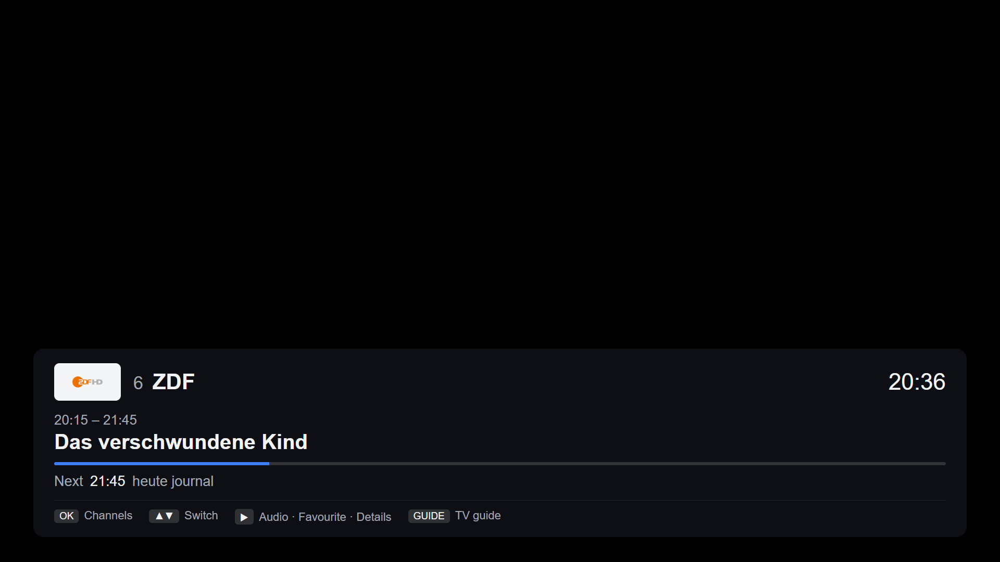
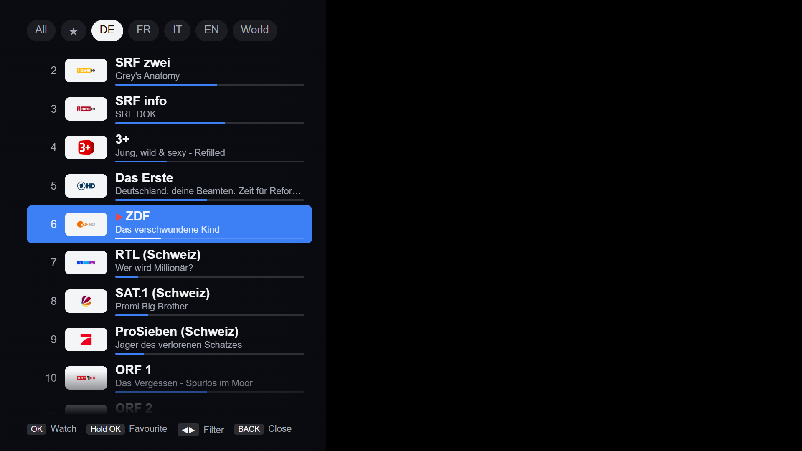
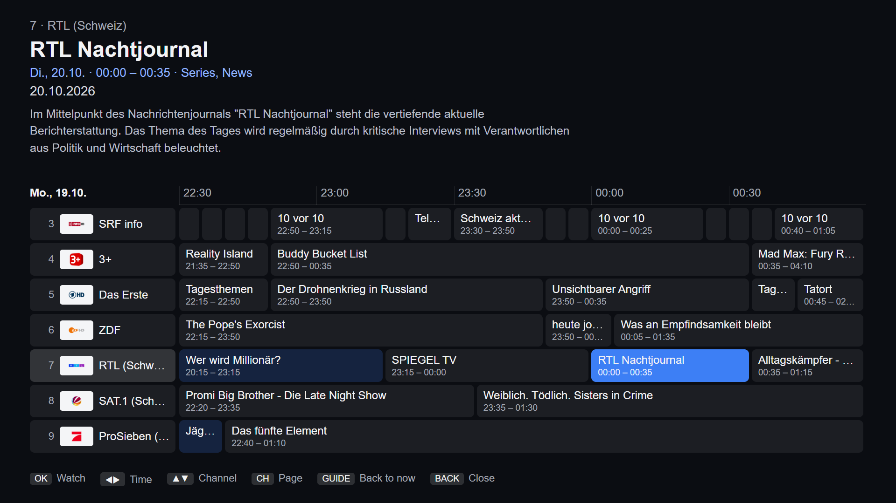
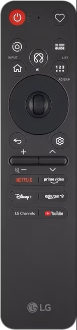

# TV for Init7 (webOS)

An unofficial LG webOS TV app for **Init7 TV7**, the IPTV service included with Swiss Init7 fibre connections.
Init7 ships official apps only for Google TV and Apple TV. This app brings TV7 to LG TVs, natively and with
a programme guide.



| Channel list with filters | Programme guide |
|---|---|
|  |  |

## Features

- **All 242 Init7 channels**: 102 via HLS, plus 140 multicast-only channels through a small relay that runs on the
  TV itself. No extra device and no router changes are needed.
- **Fast switching**: ~0.6 s on HLS channels, ~1.4 s on multicast channels
- **Programme guide** for 241 channels: info banner with now/next, programme details, and a guide grid with live
  picture-in-picture
- **Channel list** with logos, what's on now, favourites and filters (All / ★ / DE / FR / IT / EN / World)
- **Audio track list** with the broadcaster's descriptions, e.g. "Deutsch · Audio description", "Deutsch · Clean
  audio", "Dolby Digital 5.1", read live from the multicast stream. Switching stays in A/V sync (the relay delivers
  the chosen track alone; this takes ~1.5 s). The language is remembered across channels.
  The tracks are what the broadcaster sends: e.g. SRF's "English" track only carries English for foreign productions,
  while arte always offers German and French.
- Channel number entry, resumes the last channel on start
- Controls designed for the **LG AI Magic Remote** (no colour buttons needed); classic remotes work too

> **Not affiliated with Init7 or LG.** It works only on an Init7 internet connection, because Init7 grants stream
> access by your connection's IP address. No streams, logos or Init7 branding are bundled. Channel data and logos
> are loaded at runtime from Init7's public endpoints. The app collects **no telemetry**.

## Install

You need an LG webOS TV with **Developer Mode** enabled. This is free: you need an LG account and LG's
"Developer Mode" app from the LG Content Store.

1. **Enable Developer Mode**
   1. Sign in at <https://webostv.developer.lge.com> with your LG account. On the first sign-in, accept the developer
      terms.
   2. On the TV, install **Developer Mode** from the LG Content Store, sign in, switch **Dev Mode Status → ON**
      (the TV restarts), then switch **Key Server → ON**.
2. **Get the app:** download the latest `.ipk` from the
   [Releases](../../releases) page, or [build it yourself](CONTRIBUTING.md).
3. **Install it** with one of these:
   - **webOS Dev Manager**, a community desktop tool with a GUI: add the TV, then install the `.ipk`.
   - **The webOS CLI** ([Node.js](https://nodejs.org) required):
     ```sh
     npx -p @webos-tools/cli ares-setup-device   # add your TV interactively (user "prisoner", port 9922)
     npx -p @webos-tools/cli ares-novacom --device <name> --getkey   # enter the passphrase shown on the TV
     npx -p @webos-tools/cli ares-install --device <name> io.github.ardadamarda.init7tv_<version>_all.ipk
     ```

### Keep Developer Mode alive

Sideloaded apps stay installed only while the Developer Mode **session** is active. The Developer Mode app on the TV
shows the remaining time. **Press "Extend" there before it runs out.** A calendar reminder helps. If the session
expires, the TV removes the app and its favourites; re-enable Developer Mode and install again.

## Remote control



This version is tailored to the **LG AI Magic Remote (MR25)** shipped with 2025 LG TVs (pictured). It has no colour
or INFO buttons, so every function is reachable with the arrows, OK, CH, 123 and the wheel. The **GUIDE** button cannot
be used: on webOS 25 the TV catches it and opens its own guide, so the app's guide is on **◀**.

| Button | Live TV | Channel list | Programme guide |
|---|---|---|---|
| ▲ ▼ · CH ∧∨ · wheel | Switch channel | Move (CH = page) | Channel (CH = page) |
| OK | Channel list | Watch · **hold = favourite** | Watch (if on now) |
| ◀ | Programme guide | Previous filter | Earlier programme |
| ▶ | Options: audio track list · favourite · details · guide | Next filter | Later programme |
| 123 → digits (→ OK) | Channel by number; OK on the keypad switches immediately | | |
| BACK | Hide banner · press twice to exit | Close | Close |

Remotes with colour buttons: red = favourite, green = audio, blue = guide; INFO = programme details.
The pointer works as well: click rows, guide cells, or the picture.

## Compatibility

| TV | webOS | Status |
|---|---|---|
| LG OLED65G59LS (G5, 2025), firmware 43.21.77 | webOS 25 | ✅ Tested ([details](docs/ROADMAP.md#status-v100)) |
| Older models | webOS 5 – 24 | ❓ Untested. The code targets webOS 5 syntax, but codec and multicast support may differ |

Please report your TV in a [compatibility issue](../../issues/new/choose).

## Documentation

- [Architecture](docs/ARCHITECTURE.md): how HLS, the relay and the EPG fit together
- [Decisions & findings](docs/DECISIONS.md): why it is built this way, including why generic IPTV apps fail on webOS
- [Init7 API notes](docs/API.md): the endpoints the app uses
- [Roadmap](docs/ROADMAP.md): status, open tests, ideas
- [Contributing](CONTRIBUTING.md): building, deploying to your TV, debugging, tests

## License

[MIT](LICENSE)
